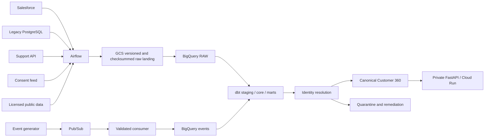

# Architecture

## Purpose and evidence levels

PropertyJourney 360 is a production-shaped data platform, not a claim that a production service is
already operating. Capabilities move through explicit evidence levels:

```text
DESIGNED -> IMPLEMENTED -> LOCALLY_VERIFIED -> CLOUD_VERIFIED -> SUSTAINED
```

No mock, local emulator or successful compilation can promote a claim to `CLOUD_VERIFIED`.

## System context



The first executable vertical slice is local and deterministic:

```text
synthetic multi-source identities
-> validated content-addressed landing
-> mutually exclusive record dispositions
-> explainable identity decisions
-> conflict-aware canonical clusters
-> Customer 360 repository
-> explicit anonymous-session link
-> masked internal API
```

## Component boundaries

| Boundary | Responsibility | Must not contain |
|---|---|---|
| `domain`, `identity`, `governance` | Pure contracts and business invariants | Airflow, FastAPI or cloud imports |
| `ingestion`, `connectors` | Watermarks, manifests and supported source APIs | Transformation business rules |
| `events` | Versioned validation, idempotency, explicit session linking | Implicit fingerprint identity |
| `dbt` | Warehouse normalisation, dimensional models and tests | Secret retrieval or orchestration |
| `airflow` | Thin scheduling, retry, backfill and gates | Identity-scoring logic |
| `api` | Authenticated, masked data-product contracts | Public access or unbounded queries |
| `infra` | Reproducible least-privilege GCP resources | Secret values or automatic production apply |

## Ingestion transaction

For each mutable API stream:

1. Read the last successful low watermark.
2. Freeze an upper watermark before extraction.
3. Query `source_updated_at > low AND source_updated_at <= high` (with a documented overlap for
   coarse timestamps).
4. Write checksummed, content-addressed raw objects and a manifest. GCS is append-only by
   application contract and versioned; it is not described as legally immutable without a real
   retention lock.
5. Validate every input into exactly one disposition: accepted, quarantined, rejected or explained
   duplicate.
6. Append RAW, deduplicate curated data by a stable ingestion key and run dbt controls.
7. Reconcile counts and hashes.
8. Advance the watermark only after required loads, reconciliation and quality gates pass.

The ingestion key is derived from source, entity, original source ID, source update time, operation
and payload hash. Original source IDs and original payloads remain traceable.

## Batch and event semantics

Airflow handles bounded batch/incremental workflows and parameterised backfills. Pub/Sub is treated
as at-least-once delivery; consumers acknowledge only after durable acceptance and deduplicate by
`event_id`. “Exactly once” is not claimed end to end.

Anonymous activity remains anonymous until an explicit `IDENTIFY` event supplies one unambiguous
customer ID. Only a bounded session window is linked; competing authenticated IDs create
`REVIEW_REQUIRED`.

## Deployment topology

- Default region: `australia-southeast1`.
- Optional private Cloud Run service for the API; the event consumer adapter is implemented but no
  managed consumer service is claimed as deployed.
- Separate service identities for ingestion, transformation, API, consumer and CI deploy.
- GCS raw bucket with public-access prevention, uniform access, versioning and dev lifecycle.
- BigQuery datasets separated by RAW, staging, core, marts and governance concerns.
- Pub/Sub dead-letter handling and observable backlog.
- GitHub Actions uses Workload Identity Federation; apply/deploy remains protected and manual.
- Local Compose uses PostgreSQL and Airflow without Redis, Celery or Kubernetes.

Cloud API reads use the API service account's BigQuery job role plus dataset-scoped viewers for
core, marts and governance. Relation identifiers are configuration-validated, values are query
parameters and every request has a maximum-bytes-billed cap. dbt custom schemas map explicitly to
the Terraform datasets when `DBT_BIGQUERY_*_DATASET` variables are supplied; intermediate models
share the staging dataset.

## External owner gates

Salesforce Developer Edition/External Client App creation, OAuth approval and secret entry; GCP
project/billing selection; initial WIF bootstrap; Terraform apply; budget notification destination;
and any 7-14 day paid validation run require the owner. Secrets are entered through a terminal or
Secret Manager, never chat or Git.
